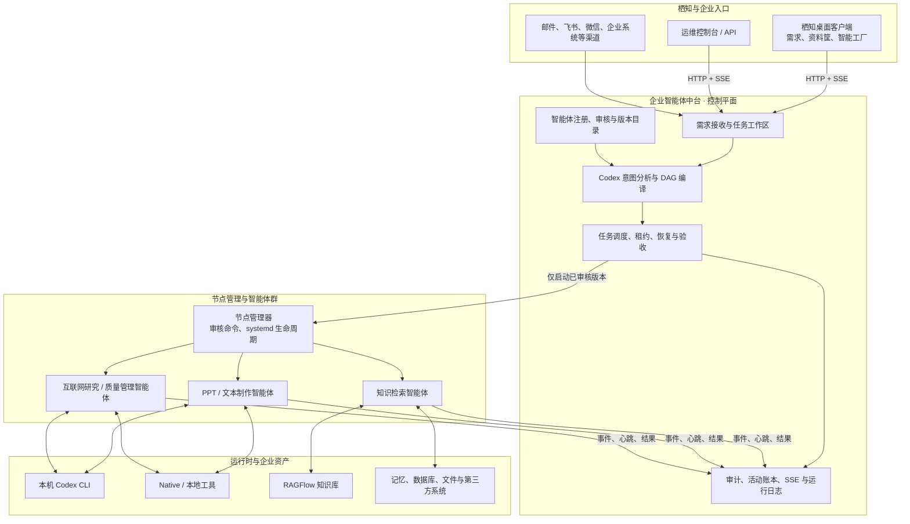

# 栖知智能体中台 · qizhi_mg

把一条自然语言需求作为一项独立任务执行。例如，用户提交“根据知识库中的项目资料制作介绍 PPT”，中台读取已审核的能力目录，请本机 Codex 规划检索、制作与质检节点，再把上游证据和文件交给下游。控制台展示各节点的耗时、进度、答复和可下载产物。

## 组成

| 模块 | 职责 |
| --- | --- |
| [控制平面](apps/control-plane/README.md) | 接收需求、编译执行图、调度、审批、审计与恢复 |
| [节点管理服务](apps/node-manager/README.md) | 从已审核版本目录解析启动命令，用独立 systemd 单元启动或停止实例 |
| [控制台](apps/console/README.md) | 提交任务和附件，通过 SSE 查看实时执行过程，回答提问、处理验收、下载交付物 |
| [智能体群](agents/) | 提供 [RAGFlow 检索](agents/ragflow-knowledge-v1.0.2/README.md)、[互联网研究](agents/web-research-v2/README.md)、[PPT 制作](agents/ppt-maker/README.md)和[质量验收](agents/quality-management/README.md) |
| [智能体协议](packages/agent-protocol/README.md) | 统一能力声明、输入信封、事件、检查点和结果格式 |

任务以 PostgreSQL 保存状态，在 `/home/middleground/data/workspaces/<task-id>/` 保存私有资料、会话和产物。明确的能力咨询可以直接从已就绪目录得到答复。需要用户补充信息的工作可以挂起，回答后从原节点继续。

## 架构图



### 从需求到交付

1. 栖知智能工厂、运维控制台或后续的企业渠道提交自然语言需求及已冻结资料；中台为其创建独立任务目录。
2. 规划器只读取处于 `ready` 状态的审核能力目录，调用 Codex 生成任务 DAG；协议编译器再校验能力、输入、依赖与资料绑定。
3. 调度器把每个可运行节点绑定到精确的智能体版本，节点管理器以独立 systemd 单元拉起实例。
4. 智能体直接使用被授权的任务本地资料和所需运行时，持续回传进度、心跳、受限输出、检查点和最终结果。
5. 中台复核租约、结果、相对工件路径与 SHA-256；合格结果进入下游节点、质量验收或成果归档，并经 SSE 回到栖知智能工厂。

## 栖知智能工厂

栖知桌面客户端 [`qizhi`](https://github.com/frogchou/qizhi) 是中台的面向业务人员的操作界面。它以需求接待大厅、智能体中台、生产线、质检中心、企业资产仓、运行时支撑、运行监控和成果交付八个园区区域呈现真实工单与系统状态。

- 默认全厂总览用于发现工作中、阻塞、待人工验收和已交付事项；
- 点击建筑进入悬浮抽屉，不缩小园区画面，可查看该区域的实时数据与操作；
- 工单详情展示已编译 DAG、节点依赖、具体智能体版本、心跳、实时输出、交付内容和可下载工件；
- 桌面端提供离线演示模式；实时模式通过 HTTP 与 SSE 对接本服务。

桌面端截图、配置说明和资料筐流转说明见 [`qizhi` 的智能工厂介绍](https://github.com/frogchou/qizhi#智能工厂)。

## 在 Linux 上运行

当前实现面向单机 Linux 和 systemd，开发环境使用 Node.js 22、pnpm 10.26.1、Docker Compose 与 PostgreSQL 16。规划及使用 Codex 的智能体需要在服务账号下安装并登录 Codex CLI；知识检索连接已有的 RAGFlow 服务。

1. 在仓库根目录安装依赖，构建前端并检查类型。

   ```sh
   corepack pnpm install --frozen-lockfile
   corepack pnpm run console:build
   corepack pnpm run typecheck
   ```

2. 在部署环境提供私有变量 `MG_POSTGRES_PASSWORD`，再执行 `docker compose -f infra/compose/postgres.compose.yaml up -d`。默认数据库为 `middleground`，容器端口映射到宿主机的 `127.0.0.1:5433`。首次启动中台时会执行数据库迁移。

3. 参考 [中台环境模板](infra/env/control-plane.env.example) 和 [节点服务环境模板](infra/env/node-manager.env.example) 配置两个独立的服务环境文件，将真实值放在仓库外，权限设为 `0600`。中台配置数据库连接、管理员令牌的 SHA-256、节点服务地址及内部令牌、RAGFlow 地址和密钥；节点服务配置同一内部令牌的 SHA-256。管理员登录时输入原始令牌。按知识库范围配置 `RAGFLOW_DATASET_IDS`。

4. 核对 [systemd 模板](infra/systemd/) 的 `WorkingDirectory`、Node 路径和 `EnvironmentFile`，按实际安装路径调整后安装服务。模板按单管理员、root 运行原型编写，部署在受信任的服务器上。先启动 `mg-node-manager`，再启动 `mg-control-plane`。

5. 按模板端口打开 `http://<服务器>:3010/console/`。在控制台批准需要的智能体版本，首次自检通过后即可调度。用“你能帮我做什么？”检查已就绪能力，再提交具体需求。

也可通过 API 提交任务。下例假设 `MG_ADMIN_TOKEN` 已由调用者在当前会话配置，响应包含可用于查看进度的 `taskId`。

```sh
curl --fail-with-body http://127.0.0.1:3010/v1/tasks \
  -H "Authorization: Bearer ${MG_ADMIN_TOKEN}" \
  -H "Content-Type: application/json" \
  -d '{"goal":"你能帮我做什么？","acceptanceMode":"platform_auto"}'
```

## 测试与验收

`corepack pnpm test` 需要将 `TEST_DATABASE_URL` 指向**专用、可清空的测试数据库**。部分集成测试会清空并重新创建表。真实 Codex、互联网和知识库的运行验证见 [smoke 测试说明](scripts/smoke/README.md)。

研究任务保留来源与引用。中台对照用户原话区分必需项和补充项，记录每轮核验结果；有缺项时，管理员可以接受当前答复，或携已有证据继续补查，原结果和归档文件保留。

## 开发与运维文档

- [智能体管理与开发总览](docs/AGENT_MANAGEMENT_AND_DEVELOPMENT_GUIDE.md) · 包生命周期、审批、调度、协议与开发原则
- [编写、登记与编排智能体](docs/runbooks/agent-orchestration.md) · [运行时](packages/agent-runtime/README.md)
- [任务私有附件](docs/runbooks/task-private-inputs.md) · [人工交互与恢复](docs/runbooks/task-human-interaction.md)
- [监控与排障](docs/runbooks/task-observability.md) · [停止任务](docs/runbooks/task-intent-and-stop.md)
- [交付验收与补查](docs/runbooks/task-delivery-acceptance.md) · [数据库设计与字段说明](apps/control-plane/src/database/README.md)
